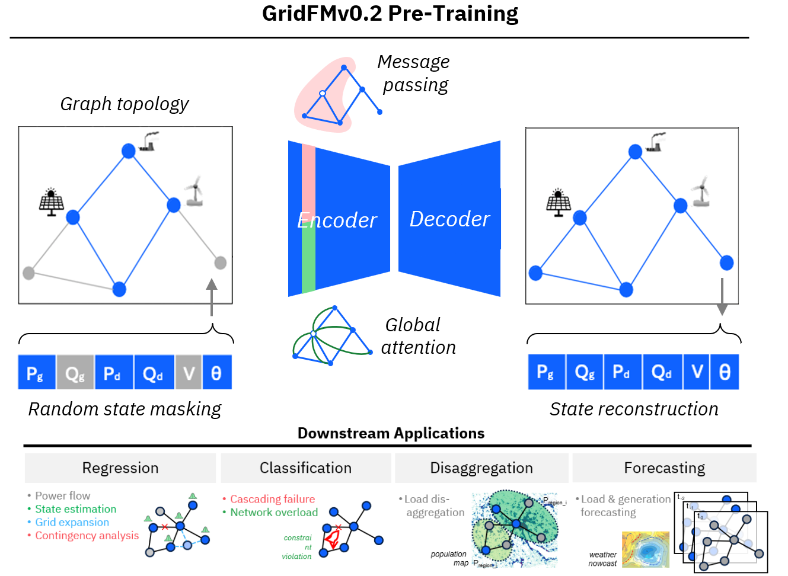

# gridfm-graphkit
[](https://gridfm.github.io/gridfm-graphkit/)


This library is brought to you by the GridFM team to train, finetune and interact with a foundation model for the electric power grid.

---

<p align="center">
  
  <br/>
</p>

# Installation

You can install `gridfm-graphkit` directly from PyPI:

```bash
pip install gridfm-graphkit
```

To contribute or develop locally, clone the repository and install in editable mode:

```bash
git clone git@github.com:gridfm/gridfm-graphkit.git
cd gridfm-graphkit
python -m venv venv
source venv/bin/activate
pip install -e .
```

For documentation generation and unit testing, install with the optional `dev` and `test` extras:

```bash
pip install -e .[dev,test]
```


# CLI commands

An interface to train, fine-tune, and evaluate GridFM models using configurable YAML files and MLflow tracking.

```bash
gridfm_graphkit <command> [OPTIONS]
```

Available commands:

* `train` – Train a new model from scratch
* `finetune` – Fine-tune an existing pre-trained model
* `evaluate` – Evaluate model performance on a dataset
* `predict` – Run inference and save predictions

---

## Training Models

```bash
gridfm_graphkit train --config path/to/config.yaml
```

### Arguments

| Argument         | Type   | Description                                                      | Default |
| ---------------- | ------ | ---------------------------------------------------------------- | ------- |
| `--config`       | `str`  | **Required**. Path to the training configuration YAML file.    | `None`  |
| `--exp_name`     | `str`  | **Optional**. MLflow experiment name.                            | `timestamp`  |
| `--run_name`     | `str`  | **Optional**. MLflow run name.                                   | `run`  |
| `--log_dir  `    | `str`  | **Optional**. MLflow logging directory.                              | `mlruns`  |
| `--data_path`    | `str`  | **Optional**. Root dataset directory.                            | `data`  |

### Examples

**Standard Training:**

```bash
gridfm_graphkit train --config examples/config/HGNS_PF_datakit_case14.yaml --data_path data
```

---

## Fine-Tuning Models

```bash
gridfm_graphkit finetune --config path/to/config.yaml --model_path path/to/model.pth
```

### Arguments

| Argument       | Type  | Description                                     | Default   |
| -------------- | ----- | ----------------------------------------------- | --------- |
| `--config`     | `str` | **Required**. Fine-tuning configuration file.   | `None`    |
| `--model_path` | `str` | **Required**. Path to a pre-trained model file. | `None`    |
| `--exp_name`   | `str` | MLflow experiment name.                         | timestamp |
| `--run_name`   | `str` | MLflow run name.                                | `run`     |
| `--log_dir`    | `str` | MLflow logging directory.                       | `mlruns`  |
| `--data_path`  | `str` | Root dataset directory.                         | `data`    |


---

## Evaluating Models

```bash
gridfm_graphkit evaluate --config path/to/eval.yaml --model_path path/to/model.pth
```

### Arguments

| Argument              | Type  | Description                                                                                                   | Default   |
| --------------------- | ----- | ------------------------------------------------------------------------------------------------------------- | --------- |
| `--config`            | `str` | **Required**. Path to evaluation config.                                                                      | `None`    |
| `--model_path`        | `str` | Path to the trained model file.                                                                               | `None`    |
| `--normalizer_stats`  | `str` | Path to `normalizer_stats.pt` from a training run. Restores `fit_on_train` normalizers from saved statistics instead of re-fitting on the current data split. | `None`    |
| `--exp_name`          | `str` | MLflow experiment name.                                                                                       | timestamp |
| `--run_name`          | `str` | MLflow run name.                                                                                              | `run`     |
| `--log_dir`           | `str` | MLflow logging directory.                                                                                     | `mlruns`  |
| `--data_path`         | `str` | Dataset directory.                                                                                            | `data`    |

### Example with saved normalizer stats

When evaluating a model on a dataset, you can pass the normalizer statistics from the original training run to ensure the same normalization parameters are used:

```bash
gridfm_graphkit evaluate \
  --config examples/config/HGNS_PF_datakit_case118.yaml \
  --model_path mlruns/<experiment_id>/<run_id>/artifacts/model/best_model_state_dict.pt \
  --normalizer_stats mlruns/<experiment_id>/<run_id>/artifacts/stats/normalizer_stats.pt \
  --data_path data
```

> **Note:** The `--normalizer_stats` flag only affects normalizers with `fit_strategy = "fit_on_train"` (e.g. `HeteroDataMVANormalizer`). Per-sample normalizers (`HeteroDataPerSampleMVANormalizer`) always recompute their statistics from the current dataset regardless of this flag.

---

## Running Predictions

```bash
gridfm_graphkit predict --config path/to/config.yaml --model_path path/to/model.pth
```

### Arguments

| Argument              | Type  | Description                                                                                                   | Default   |
| --------------------- | ----- | ------------------------------------------------------------------------------------------------------------- | --------- |
| `--config`            | `str` | **Required**. Path to prediction config file.                                                                 | `None`    |
| `--model_path`        | `str` | Path to the trained model file.                                                                               | `None`    |
| `--normalizer_stats`  | `str` | Path to `normalizer_stats.pt` from a training run. Restores `fit_on_train` normalizers from saved statistics. | `None`    |
| `--exp_name`          | `str` | MLflow experiment name.                                                                                       | timestamp |
| `--run_name`          | `str` | MLflow run name.                                                                                              | `run`     |
| `--log_dir`           | `str` | MLflow logging directory.                                                                                     | `mlruns`  |
| `--data_path`         | `str` | Dataset directory.                                                                                            | `data`    |
| `--output_path`       | `str` | Directory where predictions are saved.                                                                        | `data`    |

---
